# SmartHire – AI-Powered Job Portal

SmartHire is a full-stack job portal application developed using the MERN Stack (MongoDB, Express.js, React.js, and Node.js). It connects job seekers and employers through a user-friendly platform with job management, application tracking, resume analysis, and job recommendations.

## Features

### 1. User Authentication
- User registration and login.
- JWT-based authentication.
- Role-based access for employers and job seekers.
- Protected routes.

### 2. Job Management
- Employers can post new job opportunities.
- Edit and delete job postings.
- View available job listings.
- Search and filter jobs by title, company, location, and salary.
- Sorting and pagination.

### 3. Application Management
- Job seekers can apply for jobs.
- Track submitted applications.
- Employers can view received applications.
- Manage application status.

### 4. AI-Based Features
- Resume Analyzer to identify skills and provide resume feedback.
- Resume upload supporting PDF and DOCX files.
- Job recommendations based on resume keywords and job requirements.

### 5. Profile Management
- Update personal information.
- Manage skills, education, and experience.
- Maintain user profiles.

### 6. Additional Features
- Dashboard for users.
- Interview scheduling and email notification functionality.
- Responsive user interface.

## Technologies Used

### Frontend
- React.js
- Vite
- JavaScript
- HTML5
- CSS3
- React Router

### Backend
- Node.js
- Express.js
- MongoDB
- Mongoose
- JWT Authentication
- Multer

### Additional Libraries
- bcryptjs
- pdf-parse
- Mammoth
- Nodemailer
- Chart.js

## Project Structure

```text
SmartHire/
│
├── client/
│   ├── public/
│   ├── src/
│   │   ├── assets/
│   │   ├── components/
│   │   ├── pages/
│   │   ├── routes/
│   │   ├── services/
│   │   ├── App.jsx
│   │   └── main.jsx
│   ├── package.json
│   └── vite.config.js
│
├── server/
│   ├── config/
│   ├── controllers/
│   ├── middleware/
│   ├── models/
│   ├── routes/
│   ├── uploads/
│   ├── index.js
│   └── package.json
│
├── screenshots/
│   ├── 01-home.png
│   ├── 02-registration.png
│   ├── 03-login.png
│   ├── 04-post-job.png
│   ├── 05-my-applications.png
│   ├── 06-available-jobs.png
│   ├── 07-job-applications.png
│   ├── 08-interview-details.png
│   ├── 09-resume-analyzer.png
│   ├── 10-dashboard.png
│   ├── 11-resume-analysis-result.png
│   └── 12-job-recommendations.png
│
├── .gitignore
└── README.md
```

## Installation and Setup

### 1. Clone the Repository

```bash
git clone https://github.com/charishmasasanapuri-droid/SmartHire-AI-Powered-Job-Portal.git
```

### 2. Install Frontend Dependencies

Open a terminal and run:

```bash
cd SmartHire/client
npm install
```

### 3. Install Backend Dependencies

Open another terminal and run:

```bash
cd SmartHire/server
npm install
```

### 4. Configure Environment Variables

Create a `.env` file inside the `server` folder.

Add the following variables:

```env
PORT=5000
MONGO_URI=your_mongodb_connection_string
JWT_SECRET=your_jwt_secret
GEMINI_API_KEY=your_api_key_if_required
```

Replace the placeholder values with your own credentials.

**Important:** Never upload your `.env` file or secret credentials to GitHub.

### 5. Run the Backend

From the server directory, run:

```bash
npm run dev
```

### 6. Run the Frontend

From the client directory, run:

```bash
npm run dev
```

Open the local frontend URL displayed in your terminal.

## Main Modules

- User Registration and Login
- Job Posting and Management
- Job Search and Filtering
- Job Application Management
- Resume Analyzer
- AI Job Recommendations
- Profile Management
- Dashboard
- Interview Management

## Future Enhancements

- Advanced AI-based resume evaluation.
- Improved job matching algorithms.
- Real-time notifications.
- Enhanced analytics and reporting.
- Mobile application support.

## Screenshots

### 1. Home Page

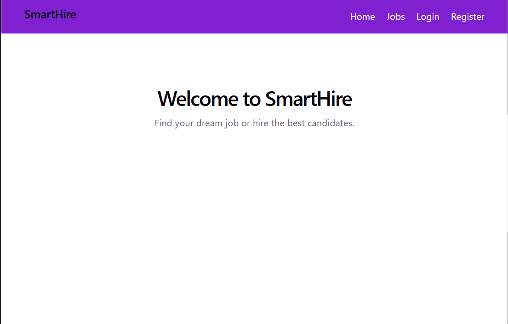

### 2. User Registration

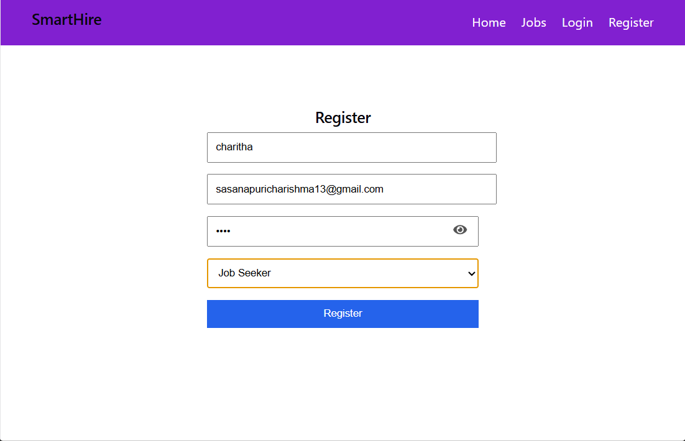

### 3. User Login

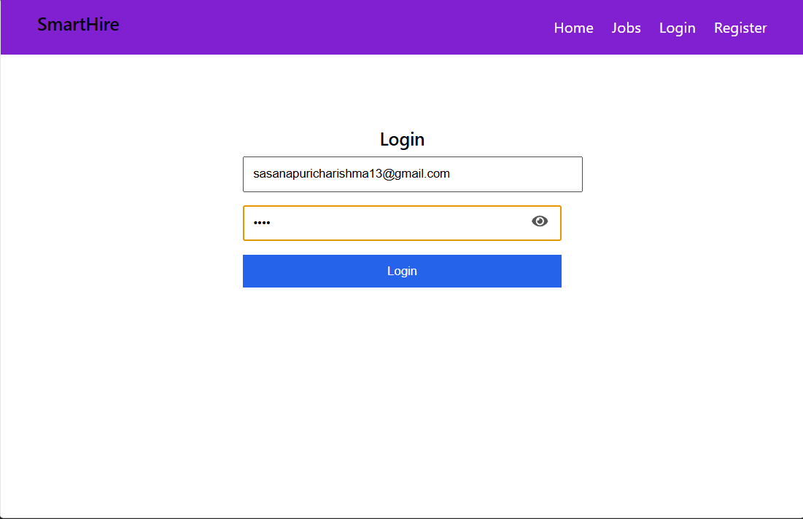

### 4. Job Posting

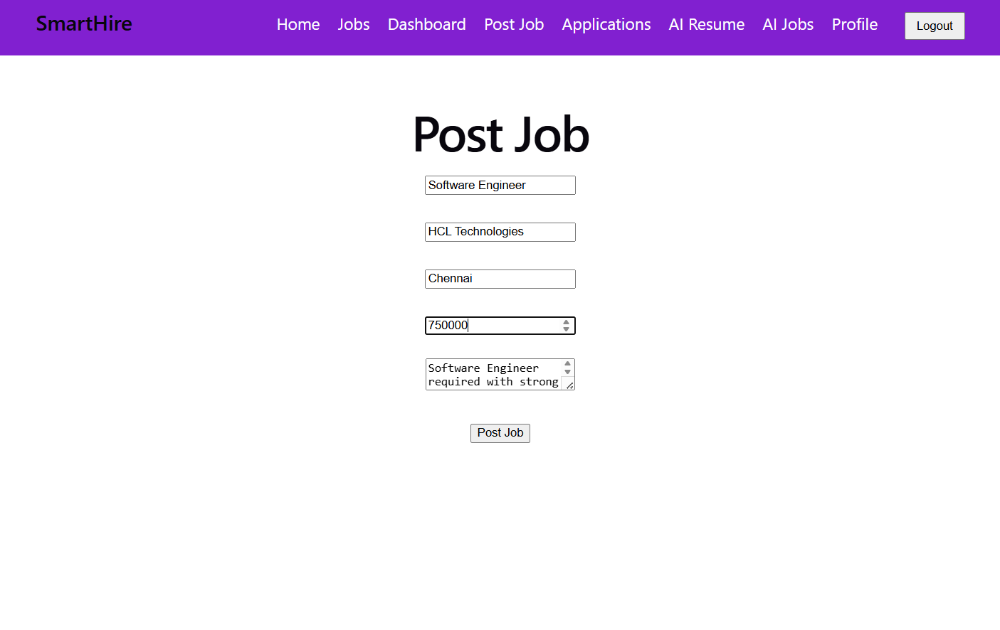

### 5. My Applications

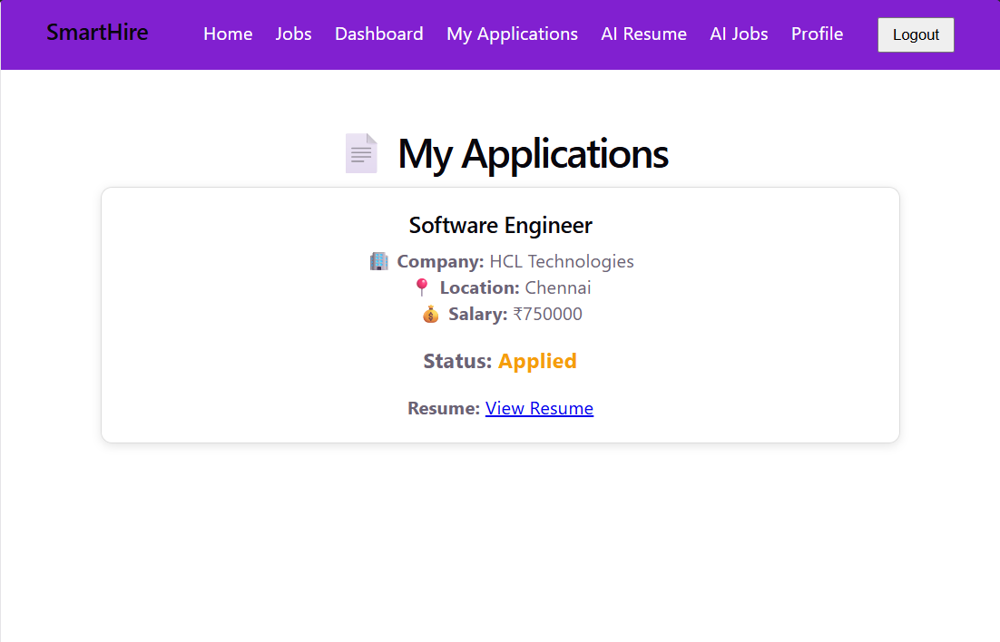

### 6. Available Jobs

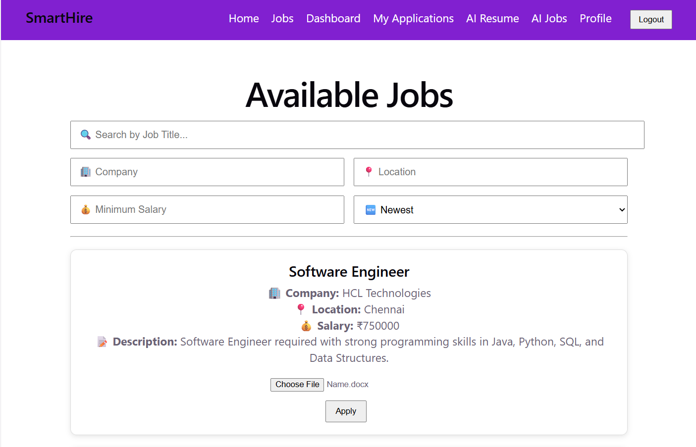

### 7. Job Applications

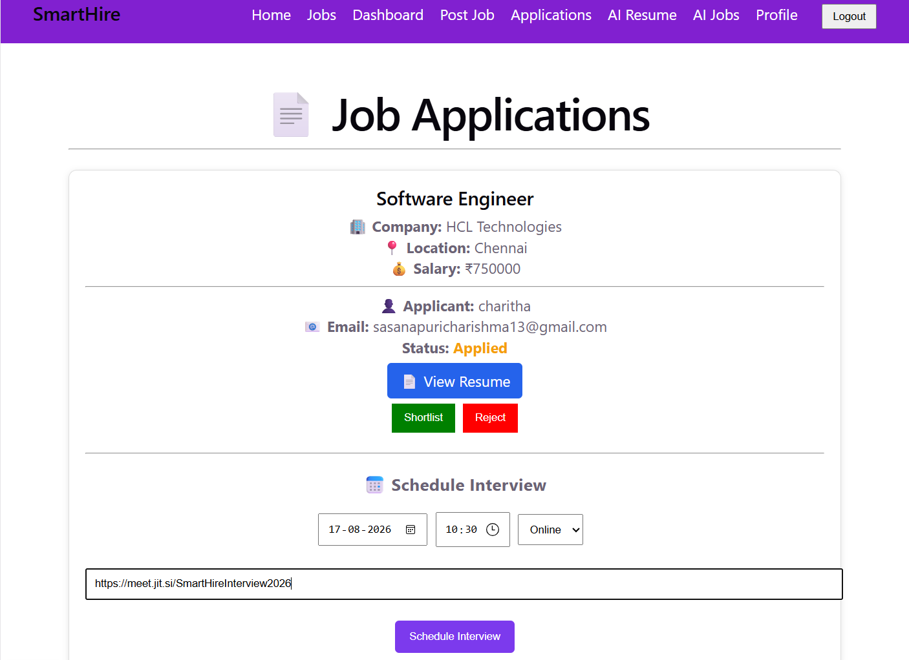

### 8. Interview Details

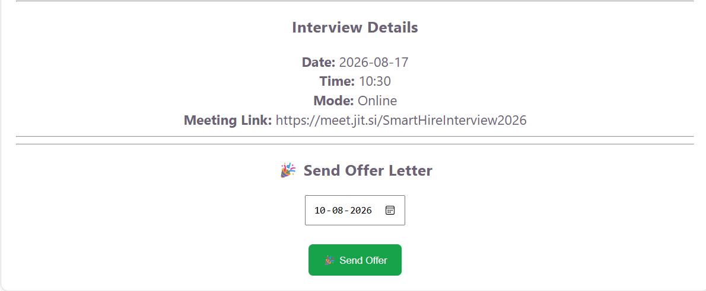

### 9. Resume Analyzer

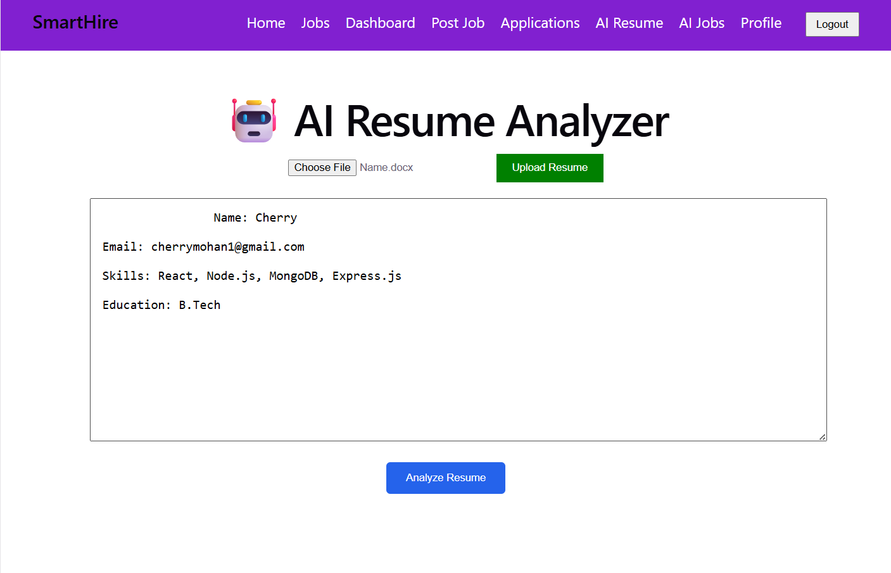

### 10. Dashboard

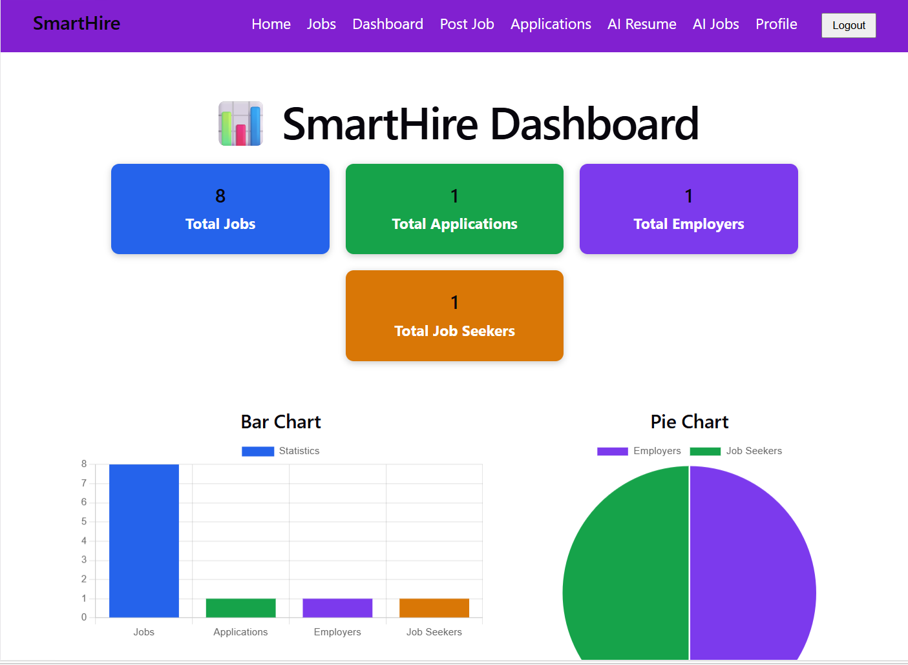

### 11. Resume Analysis Result

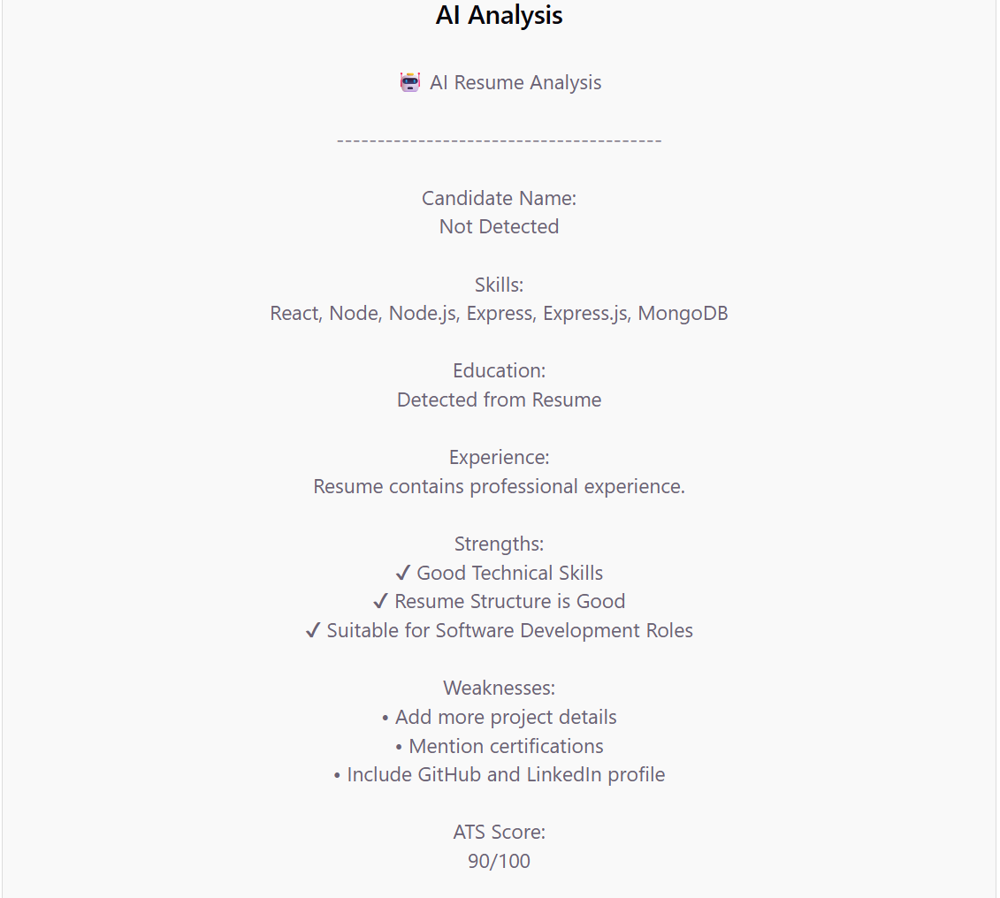

### 12. Job Recommendations

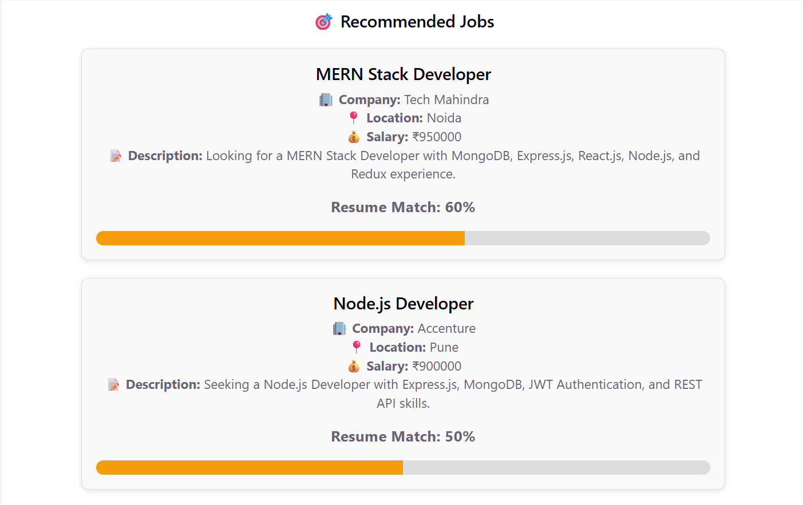

## Author

**Project:** SmartHire – AI-Powered Job Portal

**Technology:** MERN Stack

**GitHub Repository:**

https://github.com/charishmasasanapuri-droid/SmartHire-AI-Powered-Job-Portal

---

Developed as a Full Stack Major Project.